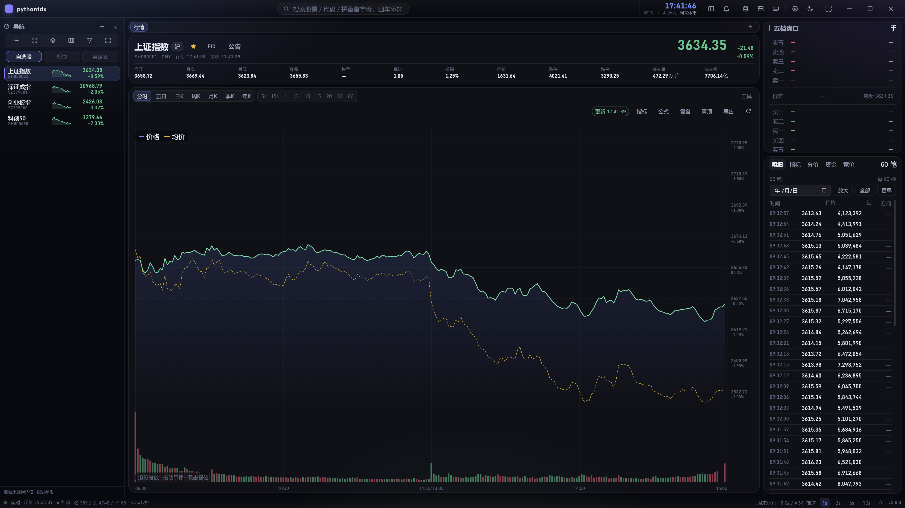
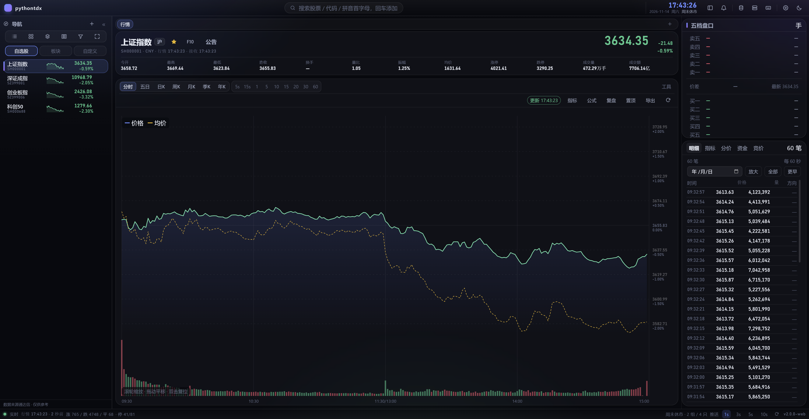
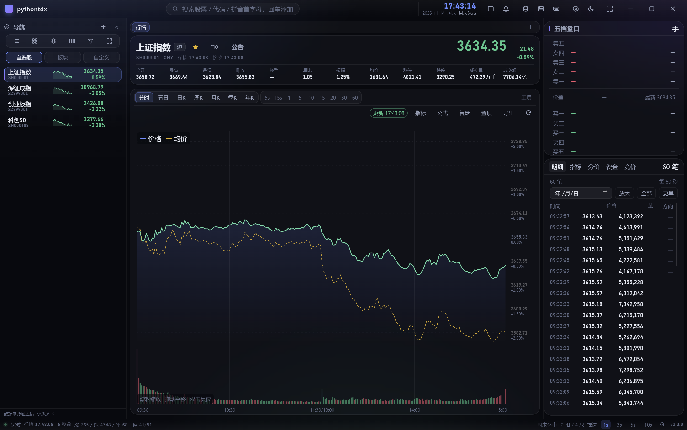
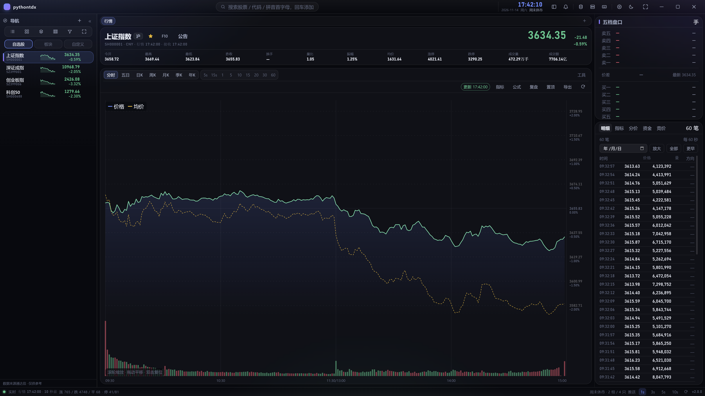
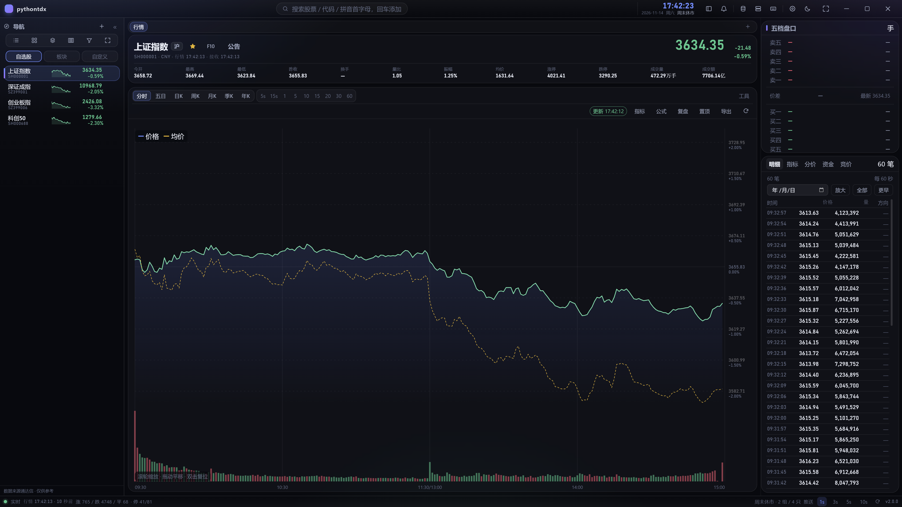
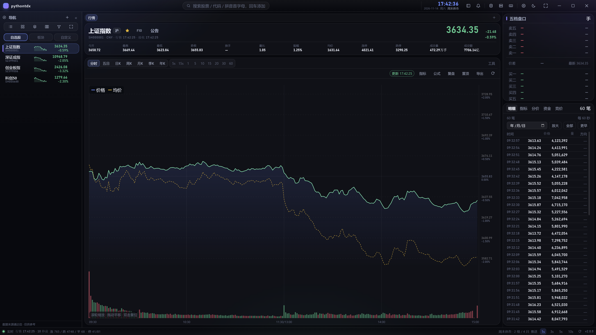
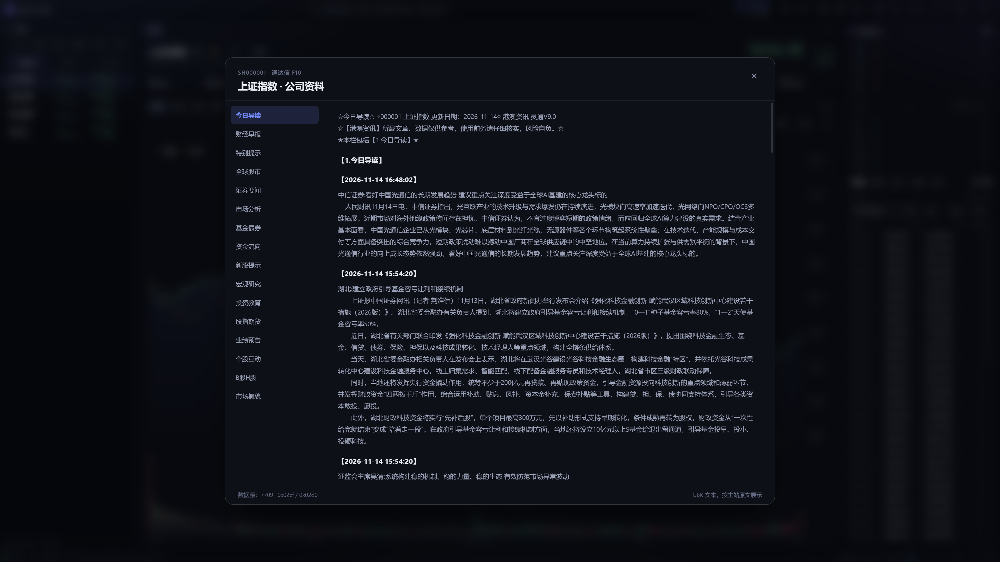
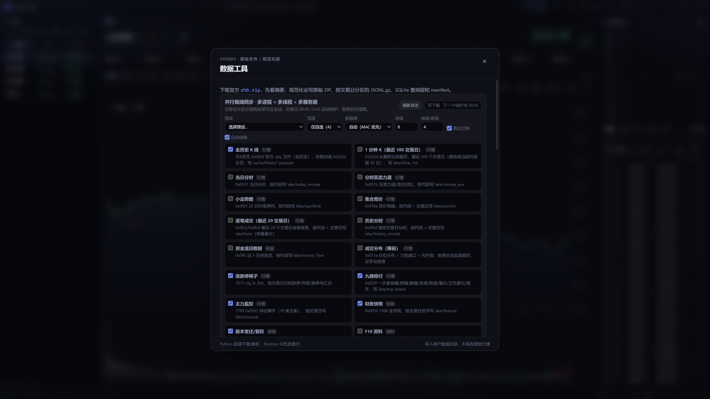
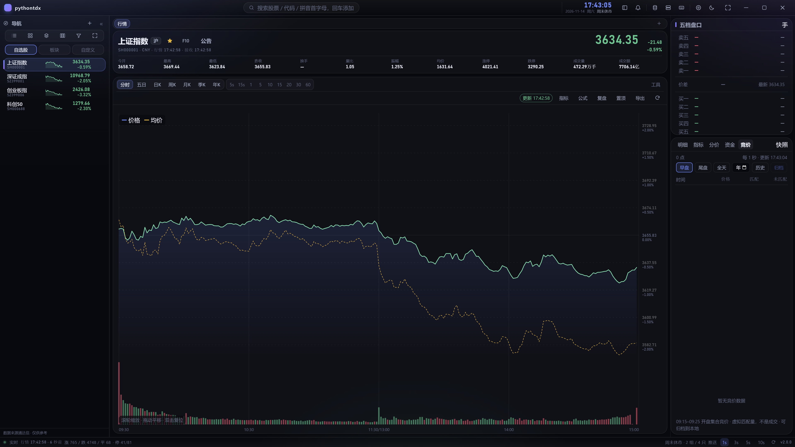

# pythontdx

**只做 A 股、只接通达信行情源**的跨平台行情终端 —— 从 0 手写通达信 7709 / MAC / 7615 协议；
Electron + SolidJS 双前端，Python 负责行情、离线数据与面向机器学习的数据湖。



[**⬇ 下载最新 Release**](https://github.com/riverzhou/pythontdx/releases/latest) ·
[功能](#功能) · [快速开始](#快速开始) · [截图](#截图) · [文档](#文档)

**v2.0.0（源码，已发布）** · GPL-3.0-or-later · Windows x64 / macOS arm64 / Linux x64  
[](https://github.com/riverzhou/pythontdx/actions/workflows/check.yml)
· `npm run check` 359 TS + 343 Python 全绿

`Electron` · `Vite` · `SolidJS` · `TypeScript` · `Python` · `Parquet / DuckDB` · `7709 / MAC / 7615`

> **English**：An A-share (China) stock market terminal built from scratch on the Tongdaxin
> (TDX) protocol — Electron + SolidJS + Python. Real-time quotes, minute/K-line charts,
> five-level order book, tick tape, F10 fundamentals, screening/alerts and a local
> Parquet data lake. Electron and the browser now share one HTTP/WebSocket data plane.
> [Download the latest release →](https://github.com/riverzhou/pythontdx/releases/latest)

**关键词**：通达信 · TDX · A 股行情 · 实时行情 · 分时 · K 线 · 五档盘口 · 逐笔 ·
选股预警 · 离线数据湖 · Electron · SolidJS · Python · 跨平台

> 如果它帮你省了点时间，**点个 Star ⭐** 能让更多搜「通达信 行情」的人找到它。

---

## 一眼看懂

- **实时行情**：1 秒刷新；分时、五日、K 线、九宫格同一节奏；
- **数据工具**：24 个离线数据集，日 K 与 1 分钟 K 独立勾选，多进程 × 多线程 × 多服务器并行；
- **协议覆盖**：7709 主站 29 条命令、MAC 15 条 A 股相关命令、7615 52 个 `fetch_*` 入口；
- **本地数据湖**：Parquet/ZSTD + DuckDB、JSONL.gz、`trade_date=` 分区、manifest + SHA256；
- **桌面 + Web**：同一套渲染层、**同一条 HTTP/WebSocket 数据协议**；
  行情缓存、K 线增量、涨跌家数统计只有 Python 一份实现。
- **主窗口化**：排行榜、板块、全市场、多股同列、选股、复盘、组合、预警、龙虎榜、
  异动、大盘资料全部是主工作区标签页；只有设置/数据/F10 等工具保留弹窗。
- **三层导航**：左栏顶部只放列表操作，右上角放全局工具，「+」统一打开所有工作区页面。

### 它做什么、不做什么

- **做**：A 股行情与数据分析的完整闭环 —— 实时行情、多周期图表、五档盘口、逐笔成交、
  F10 资料、选股与预警、公式回测、离线数据湖、桌面与 Web 双端；
- **数据源只做通达信**：7709 主站 / MAC / 7615 资料 / 官方文件下载，
  不拿腾讯、新浪、东财、AKShare 之类做兜底；
- **不做**：港股 / 美股 / 期货 / 期权、7727 扩展行情、Level-2 付费行情、交易下单；
- **定位**：学习项目，协议与字段结论都要求有报文证据（`docs/08`），
  代码质量与可读性优先于功能数量。

### Web 端：同一套界面、同一份数据、同一条协议



浏览器打开 `python/tdx_server.py --web-dir out/web` 的同一端口即可使用；
Electron 也加载同一个页面，两条入口请求同一批 `/api/*`、同一条 `/ws`。
2026-11-14 验收时桌面与 Web 同时显示 `sh000001` 3634.35、涨 765/跌 4748，
K 线/分时/逐笔/盘口一致（截图采集于 2.0.0）。

**UI 一致性验收（2026-11-14 第二轮）**：用同一套 DOM 探针跑桌面与 Web——标题栏 6 个
工具按钮、左栏「导航」（6 个快捷页 + 3 个视图）、「+」菜单 12 项/3 分组/宽 150px、
全部 A 股 200 行/迷你走势/表头 sticky/无横向溢出、6 个弹窗（数据/设置/服务器/快捷键/
F10/公告）全部可开可关、深浅主题切换生效、控制台 0 报错，两端结果一致。仅保留平台
差异：窗口按钮（桌面）、F11（桌面应用全屏 / 浏览器全屏）、设置里的「浏览器通知」（Web），
以及浏览器版备份/恢复按钮置灰并给出「请在桌面端操作」的提示。

## 2.0.0 重点：技术债清算 + 信息密度

- **同屏更多信息**：标题栏 38px、状态栏 24px、行情头约 104px、图表二级工具栏默认收起；
  1440×900 主图从约 525px 提升到 610px，排行榜同屏 18 行。
- **面板推送下沉 Python**：`PushManager` + `/api/push` SSE，渲染层不再持有面板定时器；
  断线按稳定 id 重连。
- **备份进度恢复**：`/api/progress` SSE，桌面/Web 都显示真实字节进度。
- **技术债**：TD10/11/13/19/21/22/23 已偿还；代码级未偿还项为 0。
- **分辨率**：设计基准 1920×1080，最低 1440×900（更小的窗口卡死不再适配）；
  **默认最大化启动**，从最大化还原时默认回到 **1440×900**，并记住上次最大化与窗口尺寸。
- **导航改版**：去掉标题栏四个下拉菜单；页面统一走标签栏「+」（行情/分析/资讯分组），
  全局工具收进右上角按钮，左栏顶部只留列表操作并新增一排快捷页按钮
  （排行榜 / 全A / 板块 / 多股同列 / 选股 / 行情墙）；公告与 F10 同宽、逐笔明细支持
  多列整页 + 自动滚屏、指标面板改为等距行。
- 详细清单见 [`PLAN.md`](PLAN.md) 第五节与 [`CHANGELOG.md`](CHANGELOG.md)。



## 1.7.0 重点：通讯统一 + 主窗口化

- **通讯协议统一**：Electron 主进程拉起本地 Python HTTP 服务，窗口加载
  `http://127.0.0.1:<port>`；数据面只有 `/api/*` + `/ws` 一套协议。
  `window.desktop` 只保留窗口/文件对话框/通知/本机状态；
  参考 QuantV5 的 Electron 壳做法（它也是同一个 HTTP 页面 + 极薄 preload）。
- **删除第二套传输**：`src/main/ipc.ts`、`QuotePoller`、`PushHub`、
  `src/web/http-api.ts` 全部移除；两端共用
  `src/renderer/src/lib/http-api.ts`。
- **行情显示全部进主窗口**：排行榜、板块/概念、全部 A 股、多股同列、
  条件选股、自选行情墙、复盘、组合分析、预警、龙虎榜、沪深异动、大盘资料
  都是工作区标签页；右栏在非行情标签自动收起，列表拿到完整宽度。
- **保留弹窗的只有**：设置、数据工具、F10/公告、公式/指标编辑器、
  行情服务器、快捷键。逐笔“放大”改为主区「逐笔明细」标签；独立 K 线窗口、板块选择全屏层已移除。
- **通达信习惯**：顶部「报价 / 分析 / 资讯 / 数据 / 工具」五菜单；
  F3 上证、F4 深证、F5 分时↔日 K、F6 行情、F7 公告、F9 选股、F10 资料；
  数字命令 60 排行榜、63 全部 A 股、77 龙虎榜。
- **布局**：1024 宽自动收窄侧栏/盘口、指标两行；1440 默认三栏。
- 详细边界与映射见 [`docs/23`](docs/23-前后端边界与双端一致性.md)。

## 1.6.1 修复：非交易日的时间归属

- **分时基准**：周末/节假日/凌晨时 `0x0537` 是上一交易日的数据，现已按
  `shanghai_clock` 的 session 取「日线最后一根」为交易日、昨收取再往前一根；
- **日 K 假 bar**：实时报价只在开盘后（含收盘后）补当天 K 线，
  周末不再造出不存在的交易日；
- **离线 `fetchedAt`**：统一按 `+08:00` 写，UTC 环境下不再把缓存判成前一天。

细节见 [docs/releases/1.6.1.md](docs/releases/1.6.1.md)。

## 1.6.0 重点：TDX 交易日历 + 部署模式收口

- **不再手写节假日表**：内置通达信官方 `Except2025/2026.zip` 里的
  `neednote_RecentHSHoliday.txt` 快照，再用 MAC `0x120F` 的
  `today` / `lastTradingDay` 识别临时休市；
- **全链路生效**：桌面 Poller、Web SSE/WS、分时/K 线/逐笔刷新、离线同步
  08:45–15:45 保护窗口都使用同一份日历；节假日显示「节假日休市」，轮询自动降频；
- **新增接口**：`market_status` 命令 / `POST /api/market_status`，启动与每 5 分钟刷新；
- **部署模式**：Electron 桌面与 Web **二选一，不同时使用**；同机只允许一个
  Python 后端持有 7709 连接（`PRINCIPLES.md` A6）。
- 未来年份未覆盖时按工作日 + 服务端状态，不伪造交易日；可在
  `<数据目录>/trading_holidays.json` 追加临时休市日。

## 1.5.0 重点：PR 收口 + 数据逻辑归 Python

### 社区 PR #1 合并

社区提交的 `perf/closing-downshift-and-locks` 已合并，主要包含：

- 收盘/午休自动降频：桌面 `QuotePoller` 与 Web SSE/WS 都按交易时段降速；
- 涨跌家数改分页扫描，页间释放行情锁；Web 端加缓存与跨日失效；
- F10 路由移出行情锁，7615 网关按延迟选择并冷却失败站点；
- 行情编排（快照 → 增量 → 合并 → 竞价 → MAC 兜底）下沉 Python Bridge；
- 逐笔面板收盘后降频；K 线推送防重入。

### 审核后修掉的问题

- **`updateTime` 变成 JSON `null`**：Python 合并把字段置 `None`，状态栏用
  `!== undefined` 判断，盘中会把行情时间显示成「—」。现在 Python 删除该字段，
  状态栏同时兼容 `null`。
- **Windows 跨源写请求断连**：服务端拒绝写请求时没读完请求体，Windows 发 RST，
  客户端拿不到 403；现在先排空再响应。
- **时段边界盲区**：轮询在 12:59:59.6 醒来时会跳过 0~500ms 的边界，开盘第一帧
  被拖后 30 秒；TS/Python 两侧都改为不跳过临近边界，并补了测试。
- **取消订阅后空转**：`QuotePoller` 在途请求的 `finally` 会把定时器复活；
  现在用 `active` 标记阻止，并过滤主动取消产生的错误帧。
- **实时 K 线每秒落盘**：tail 请求原来每秒重写 20 根 parquet；现在 tail 不落盘，
  只有首帧/60 秒全量落盘。

### 架构重整：TS 只展示，Python 管数据

两条新原则写入 [`PRINCIPLES.md`](PRINCIPLES.md)：**A2**（数据逻辑归 Python，
前端 TS 只负责展示与传输）与 **A8**（Web/Electron 同源：同一命令、同一响应、
同一测试）。落地结果：

| 能力                               | 1.4.0                                   | 1.5.0                                |
| ---------------------------------- | --------------------------------------- | ------------------------------------ |
| 实时行情合并/竞价/MAC 兜底         | 桌面 TS + Web 各一套                    | Python `live_quotes` 一份            |
| 分时 10s / 五日 60s / K 线 60s TTL | 桌面主进程缓存，Web 无缓存              | Python `*_cached`，两端同 TTL        |
| 实时 K 线 tail/断层/60s 全量       | `shared/kline-live.ts` + Web 标签页缓存 | Python `kline_live`，缓存只在 Bridge |
| 涨跌家数扫描/计数/TTL/跨日         | 桌面 TS 缓存 + Web 服务端缓存           | Python `breadth_begin/step` 一份     |
| 行情时段降频                       | 桌面 TS / Web Python 各一套             | 同一组测试向量；壳只做传输调度       |

详细映射、缓存规则、反模式与发布前核对表见
[`docs/23-前后端边界与双端一致性.md`](docs/23-前后端边界与双端一致性.md)。

---

## 截图

### 主图：指数 K 线、成交量、盘口


主图上方是今开/最高/最低/昨收、换手、量比、振幅、均价、涨停/跌停、成交量/成交额；
右侧五档盘口 + 明细/指标/分价/资金/竞价页签；下方成交量与 MACD 副图。
指数成交量已统一成「手」，与 K 线同单位。

### 多股同列：九宫格分时 / K 线


- 固定 3×3，默认全天分时（240 个交易分钟固定横轴）；
- 可切日/周/月/60/30/15/5/1 分；
- 自选/自定义超过 9 只自动分页，卡片可拖动调整九格布局，点击卡片切主图。

### 全市场列表



20 列：代码/名称/现价/涨跌幅/成交额/换手/量比/涨速 + 今开/最高/最低/昨收/成交量/
均价/振幅/涨停/跌停/总市值/流通市值/迷你走势；列多时表格内部横向滚动，页面主体不横滚。

### 排行榜与板块





排行榜复用同一套指标列；板块/概念左侧板块栏 + 成分股表，迷你走势按可见行懒加载。

### F10：目录 + 在线页签



F10 是 16 段目录（0x02cf），「公告」面板另有 19 个在线页签；固定 1056px 阅读宽度，正文/表格/公告链接/GBK 原文按段落渲染；
个股结果自动写 point-in-time 快照。

### 数据工具：并行同步 + 真实进度



- 默认 **8 进程 × 4 线程**，可调 1–48 × 1–4；一进程钉一台主站，48×4 = 192 条连接；
- 日 K（全历史，官方 `.day` 文件）与 1 分钟 K（最近 100 交易日）是两个独立选项；
- 逐笔成交默认最近 **20 个交易日**；
- 数据集、范围、数据源、进程/线程、跳过已有、自动续跑会持久化；
- 每个耗时操作都有进度条：探测/计划/完成数/吞吐/ETA、下载 zhb.zip、扫描/校验、
  备份/恢复字节进度、K 线导出、全市场快照、数据湖归档、本地导入/写回；
- 最近任务摘要显示完成/跳过/失败/行数/总耗时，中断任务可单独续跑；
- 08:45–15:45 自动保护：窗口内启动返回 `blocked`，跑到一半暂停，15:45 后续跑。

### 尾盘集合竞价



「竞价」页签支持 **早盘 / 尾盘 / 全天**：

- 早盘 09:15–09:25；
- 尾盘 14:57–15:00（`0x056a selector=1`）；
- 全天合并；虚拟匹配量不是正式成交，15:00 最终成交看「明细」。

---

## 数据下载与缓存

### 并行模型

```text
父进程探活全部主站 → 拉一次代码表 → 按数据集/代码/日期切片
  → N 个 worker（每进程钉一台主站）
      → 每 worker T 条线程（每条独立 7709 连接）
```

- 开发态与打包态共用 `offline_sync.py --worker` / `tdx-bridge --offline-worker`；
- 任务级断点续跑：有效的同名归档直接跳过，损坏副本才允许重写；
- worker 每 1.5 秒原子写进度，父进程只读文件，不阻塞状态查询；
- Windows 看门狗用 `OpenProcess + WaitForSingleObject`，不会误发 Ctrl+C。

### 跳过规则

| 数据       | 规则                                                                                |
| ---------- | ----------------------------------------------------------------------------------- |
| 日 K       | 缓存 manifest 有效；当天已刷新但官方仍是旧日期的北交所/停牌代码，当天跳过，次日再试 |
| 1 分钟 K   | 当前 `trade_date` 分区有文件 + manifest + rows；旧 `complete=false` 也跳过          |
| 逐笔       | `trade_date=<day>/<code>.parquet` + manifest + rows/bytes                           |
| auction    | 专用 manifest（SHA 是解压后 JSONL）按 rows/code/date 校验                           |
| money_flow | 旧 manifest 无 rows，按 code/date/bytes 校验                                        |
| 明确无数据 | 写 `.nodata.json`，下次同代码/日期跳过；只标记 no-data，不标记超时                  |

规划阶段不对十几万份逐笔逐个读全文件算 SHA；完整计划约 **6–7 秒**。

### 实测

```text
1m 100 只：48×4 8.2s / 8×4 12.3s
日K 100 只：16×4 6.2s / 48×4 12.2s
```

这台 8 核/16 线程机器上，48 进程不总是更快；默认 8×4 更稳。

### 实时缓存（1.5.0）

| 数据      | 位置                        | TTL/窗口                                   |
| --------- | --------------------------- | ------------------------------------------ |
| 实时报价  | Python `live_quotes` + 游标 | 每次调用；快照覆盖价格、增量保留五档       |
| 分时      | Python `_minute_cache`      | 10 秒；推送传 `fresh=true` 绕过            |
| 五日      | Python `_five_day_cache`    | 60 秒；推送传 `fresh=true` 绕过            |
| K 线      | Python `_kline_cache`       | 60 秒；`cacheOnly` 先读本地 parquet        |
| 实时 K 线 | Python `_kline_live_cache`  | tail 20 根；60 秒补全量；断层重取          |
| 涨跌家数  | Python `_breadth_cache`     | 交易 15s / 午休 120s / 收盘 300s；跨日失效 |

非交易时段轮询放大 10 倍、最少 30 秒；等待被下一次交易时段边界封顶。
桌面与 Web 使用同一组规则（`pollDelayMs` / `_quote_interval`）+ 同一组测试向量。

---

## 功能

### 行情与图表

- 7709 实时快照/增量刷新，MAC 批量报价兜底；
- 分时 / 五日 / 多周期 K：5s、15s、1–60 分钟、2–45 日、日/周/月/季/年；
- 五档盘口、逐笔、分价、集合竞价、资金流；
- 均线、BOLL、成交量、MACD/KDJ/RSI 等副图；线性/对数坐标；
- 缩放、平移、十字光标、区间统计；
- 画线：趋势线/水平线/垂直线/文字/斐波那契/测量/箭头/平行通道，
  吸附、拖动、复制粘贴、撤销/重做、按复权隔离、日期锚点持久化；
- 多股同列、自选行情墙、窗口置顶；行情相关页面全部在主工作区标签内。

### 资料、选股与复盘

- F10：16 段目录；公告/在线资料：19 个页签（公司概况、估值、财务…）；
- 左栏「自选股 / 板块 / 自定义」三视图，自选/自定义可拖拽排序；
- 排行榜：涨幅/成交额/涨速/换手/量比/市值/资金流等；
- 条件选股、预设、自动股票池、公式选股、单标的/组合回测；
- 复盘：日 K 逐根、分时逐分钟、历史逐笔回放；
- 离线数据单文件备份/恢复；备份/恢复有真实字节/文件进度。

### 数据与协议

- **7709**：29 条命令；K 线、分时、逐笔、竞价、财务、F10、文件、代码表；
- **MAC**：15 条 A 股相关命令；报价/K 线/分时/逐笔/竞价/板块/资金流/文件元信息；
- **7615**：52 个 `fetch_*`、9/9 HQServ 页、20 个行业子页、84 个资讯频道、涨跌停梯子；
- **gpcw 历史财务**：5,572 只 × 658 float，写 `lake/finance_history`；
- **本地 GBBQ**：本机 202,313 条，解密后写 `lake/gbbq`；
- **归档去重**：按 `trade_date` 或「代码/业务 key」分片，合法同名归档保留第一版，
  只有损坏副本才允许重写；
- **并发安全**：分区级文件锁 + 唯一临时文件 + 原子替换；
- **窗口保护**：交易日 08:45–15:45 不下载离线数据，实时查询不受影响。

> MAC 不是 7709 超集：没有代码表/F10/136B 财务/股本变迁/特殊涨跌停/退市/九榜；
> 采用 MAC 优先 + 7709 兜底。0x1217 文件分片已实现，但测试主机返回空分片，
> 生产下载仍走 0x06b9。边界见 [docs/19](docs/19-MAC协议与数据源策略.md)。

---

## 数据湖

```text
~/.local/share/pythontdx/data/
  raw/tdx/          原始 ZIP / 文件（不可变）
  cache/klines/     K 线 Parquet + manifest
  lake/             一类数据一个子目录（见下表）
  exports/          导出 CSV / JSON / Parquet
```

| lake 子目录                                          | 内容                                       |
| ---------------------------------------------------- | ------------------------------------------ |
| `today_minute` `minute_aux` `sparkline`              | 当日分时、买卖力道、小走势                 |
| `kline_1m` `recent_minute` `history_minute`          | 1 分钟 K、近期分时、历史分时               |
| `ticks` `auction`                                    | 逐笔成交、集合竞价                         |
| `category_quotes` `quotes` `volume_profile`          | 分类行情、实时快照、成交分布               |
| `top_board` `unusual` `limit_ladder` `special_limits` `delisted` | 九榜、异动、涨跌停梯子、特殊涨跌停、退市 |
| `money_flow` `finance` `corporate` `finance_history` `gbbq` | 资金流、136B 财务、股本变迁、gpcw、GBBQ |
| `f10_pit` `f10_detail` `f10_market` `channel_news` `market_news` | F10 快照与在线页、频道新闻、大盘新闻 |
| `server_files` `server_meta` `datasets` `offline_sync` | 服务器文件清单、元数据、通用数据集、同步进度 |

每份归档带 manifest（来源、时间、行数、SHA256、文件列表）；
`data_coverage` 扫描覆盖，`data_integrity` 逐份校验 manifest/SHA256。
**正常显示问题不需要重新下载历史数据**——缓存有校验，只有损坏副本才允许重写。
本地数据默认永久保留，不提供清理/删除入口。

---

## 快速开始

### 直接用（推荐，不必装 Python）

从 [Releases](https://github.com/riverzhou/pythontdx/releases/latest) 下载对应平台的产物：

| 平台        | 文件                                                                                      |
| ----------- | ----------------------------------------------------------------------------------------- |
| Windows x64 | `pythontdx-<版本>-setup.exe`（安装版）/ `-portable.exe`（单文件）/ `-win-x64.zip`（绿色） |
| macOS arm64 | `pythontdx-<版本>-arm64.dmg`                                                              |
| Linux x64   | `pythontdx-<版本>.AppImage` / `pythontdx_<版本>_amd64.deb`                                |

打包版自带本地行情服务（Nuitka 单文件），用户不需要安装 Python；Windows 包是自签名，
只保证完整性，SmartScreen 仍会提示「未知发布者」。

### 从源码：依赖

- Node.js ≥ 20.19（实测 24.x）
- Python ≥ 3.10（开发/后端；打包版用户不需要）
- duckdb、pyarrow/pandas/numpy、Nuitka（构建本地服务单文件时需要）

### 开发

```bash
npm install
python -m pip install -r requirements.txt

npm run dev          # 桌面：Electron + Vite + 本地 Python 服务（8765）
```

Web（与桌面同一套页面，可选）：

```bash
python python/tdx_server.py --port 8765
npm run dev:web
```

### 检查与构建

```bash
npm run check        # 类型 + Lint + TS 测试 + Python 测试
npm run build        # 主进程/preload + Web 产物（out/main、out/preload、out/web）
npm run build:web    # 只构建 Web 产物 out/web
npm run build:win    # Windows 安装包/便携版/绿色 zip
npm run build:linux  # AppImage + deb
npm run build:mac    # macOS arm64 dmg
```

发布产物在 `release/<version>/`；打 tag 后 GitHub Actions 构建三平台并上传 Release。
完整步骤见 [docs/07-手动编译发布手册](docs/07-手动编译发布手册.md)。

---

## 项目结构

```text
src/main/        桌面壳：index.ts（装配）+ services/（窗口/托盘/服务拉起/壳 IPC）
src/preload/     contextBridge 白名单（只暴露 window.desktop）
src/shared/      两端共享的契约与纯函数（禁平台 API）
src/renderer/    SolidJS 界面（桌面与 Web 共用）：components / stores / lib / styles
src/web/         Web 入口（只 import 共享渲染层）
python/          通达信协议 + 本地 HTTP/WS 服务 + 数据任务 + 数据湖
  tdxproto/      协议层（常量/编解码/连接/请求/解析/板块，单向依赖）
  tests/         Python 测试（与源码分离）
  fixtures/      真实报文与节假日快照
scripts/         工具链：python.mjs + build / dev / data / probe
docs/            章程、架构、协议、发布记录（入口见 docs/README.md）
```

新代码位置：

- 新协议/字段解析 → `python/tdxproto/parsers.py`（块数据 `blocks.py`，常量 `constants.py`）
  + `python/tests/test_tdx.py` / `test_parsers.py` + fixture；
- 行情缓存/合并/TTL/统计 → `python/tdxproto/cache.py` + `python/tdx_bridge.py`（不要再写 TS 版）；
- 主机探活/落盘/补历史 → `python/`；
- 桌面/Web 共用界面 → `src/renderer/`；
- 平台外壳 → `src/main/services/`；
- 全局状态 → `src/renderer/src/stores/`；
- 数据与壳调用 → `src/renderer/src/lib/client.ts`（不直接 fetch / 不直接读 window.desktop）；
- 颜色/间距/动效 → `src/renderer/src/styles/tokens.css`。

**边界原则**：TS 只负责展示与传输；数据逻辑、缓存、合并、统计只在 Python。
落位与命名规则见 [`docs/24`](docs/24-项目结构与命名规范.md)，
分层取舍见 [`docs/23`](docs/23-前后端边界与双端一致性.md)。

---

## 文档

| 文档                                                                | 内容                                   |
| ------------------------------------------------------------------- | -------------------------------------- |
| [docs/00-项目章程](docs/00-项目章程.md)                             | 目标、范围、六条核心要求               |
| [docs/02-架构](docs/02-架构设计.md)                                 | 双前端、Python 数据层、数据流          |
| [docs/03-通达信协议](docs/03-通达信行情手册.md)                     | 7709/MAC/7615 字段与报文               |
| [docs/07-编译发布](docs/07-手动编译发布手册.md)                     | 构建、验收、发布记录                   |
| [docs/08-通达信资料索引](docs/08-通达信资料索引.md)                 | 协议来源、探针、研究台账               |
| [docs/12-数据覆盖审计](docs/12-数据覆盖审计.md)                     | 每个数据集的实际覆盖与边界             |
| [docs/18-离线数据并行同步](docs/18-离线数据并行同步.md)             | 多进程/多线程、缓存、1m、性能          |
| [docs/19-MAC协议与数据源策略](docs/19-MAC协议与数据源策略.md)       | MAC 覆盖与回退                         |
| [docs/21-通达信协议总表](docs/21-通达信协议总表.md)                 | 命令/入口/字段总表                     |
| [docs/22-前端设计与开发方案](docs/22-前端设计与开发方案.md)         | 界面结构、设计令牌、图表、状态         |
| [docs/23-前后端边界与双端一致性](docs/23-前后端边界与双端一致性.md) | TS/Python 边界、映射、核对表           |
| [docs/24-项目结构与命名规范](docs/24-项目结构与命名规范.md)         | 分层、目录、命名、落位规则             |
| [docs/25-全库审计报告](docs/25-全库审计报告.md)                     | 审计范围、方法、发现与复核命令         |
| [docs/README.md](docs/README.md)                                    | 全部文档的入口与分类索引               |
| [CHANGELOG.md](CHANGELOG.md)                                        | 版本变更                               |
| [docs/releases/](docs/releases/README.md)                           | 逐版本发布说明（1.0.0 → 2.0.0）        |

---

## English

**pythontdx** is a cross-platform A-share (China) market terminal written from scratch.
It speaks the Tongdaxin (TDX) protocol directly — primary quote servers on TCP 7709,
MAC market data, the 7615 fundamentals gateway, plus official file downloads — and keeps
everything local as Parquet (ZSTD) with manifests and SHA-256 checksums.

- **Two front ends, one UI**: Electron desktop and the browser share the same
  SolidJS renderer, design tokens and one local HTTP/WebSocket data plane.
  The desktop shell only provides window/tray/file-dialog/state IPC.
- **One data implementation**: all quote, cache and incremental logic lives in Python
  (`python/tdxproto/` for the protocol layers, `python/tdx_bridge.py` for orchestration);
  TypeScript only renders and transports.
- **A data lake meant for ML**: immutable raw messages, normalized Parquet,
  `trade_date` partitions, point-in-time F10 snapshots, delisted/suspended symbols kept.
- **Scope on purpose**: A-shares only — no HK/US/futures/options, no Level-2, no order
  routing, and no third-party data vendors as fallback.
- **Status**: 2.0.0 source (released) · GPL-3.0-or-later ·
  Windows x64 / macOS arm64 / Linux x64 ·
  `npm run check` green (359 TS + 343 Python tests).

Download: [Releases](https://github.com/riverzhou/pythontdx/releases/latest).
Run from source: `npm install && python -m pip install -r requirements.txt && npm run dev`.
Documentation is currently Chinese-first — start at [docs/01](docs/01-快速开始.md) or
[docs/02](docs/02-架构设计.md).

---

## 常见问题

**Q：需要自己安装 Python 吗？**
不需要。Releases 里的安装包 / 便携版自带本地行情服务（用 Nuitka 打成的单文件）；
只有从源码开发、或单独跑离线同步脚本时才需要 Python 3.10+。

**Q：数据从哪来？能商用吗？**
全部走通达信公开行情服务：7709 主站、MAC 行情、7615 资料网关、官方文件下载
（`vipdoc` 等），与官方客户端同源；不做登录、不做交易、不碰付费 Level-2。
本项目是 GPL-3.0 的个人学习项目，**行情数据的授权与使用风险请自行判断**，
不构成投资建议。

**Q：和 mootdx / pytdx 这类库有什么区别？**
那些偏「取数据的库」；这个项目是端到端的行情终端 —— 协议层、Python 数据层、
桌面 / Web 界面、离线数据湖一起做，取舍不同，按需选择。

**Q：支持港股 / 美股 / 期货吗？**
不做，只做沪深京 A 股；通达信 7727 扩展行情（EX）也不做。

**Q：能直接拿来跑策略回测吗？**
能取数据，但没有撮合级回测引擎。仓库提供 Parquet + DuckDB 离线数据、公式与简易回测，
数据可直接喂给 pandas 或你自己的框架（面向 ML 的长期目标见 `docs/00-项目章程.md`）。

**Q：为什么要做成「像通达信」的样子？**
目标是对齐官方客户端的行情、分析、选股、资料能力（见
[docs/09-官方客户端功能清单](docs/09-官方客户端功能清单.md)），
布局与术语刻意贴近，降低从官方客户端迁移的成本。

---

## 边界

- 只做 A 股 + 通达信；7727/EX、港股/美股/期货不做。
- `ticks`/`history_minute` 全市场是天量数据，默认只对自选或最近窗口；
  全市场需要显式确认磁盘空间。
- `f10` 的 `full` 档每只约 30 次 7615 请求，全市场首次建库以小时计；默认 `core`。
- 7615 没有公开并发/限流文档，线程数过大可能被限流；失败会在下次续跑。
- 退市代码不在当前代码表里，`delisted` 必须显式提供代码。
- `volume_profile`（0x051a）在免费主站全部超时，不进预设。
- 交易日历内置 2025/2026 TDX 官方快照；未来年份未覆盖时按工作日 + `0x120F`，
  可在数据目录放 `trading_holidays.json` 追加临时休市日。
- **桌面与 Web 二选一部署，不同时使用**：同一台机器只允许一个 Python 后端持有 7709 连接；
  两种模式共用同一批 Python 数据方法，但不设计双开后端/共享缓存（见 `PRINCIPLES.md` A6）。
